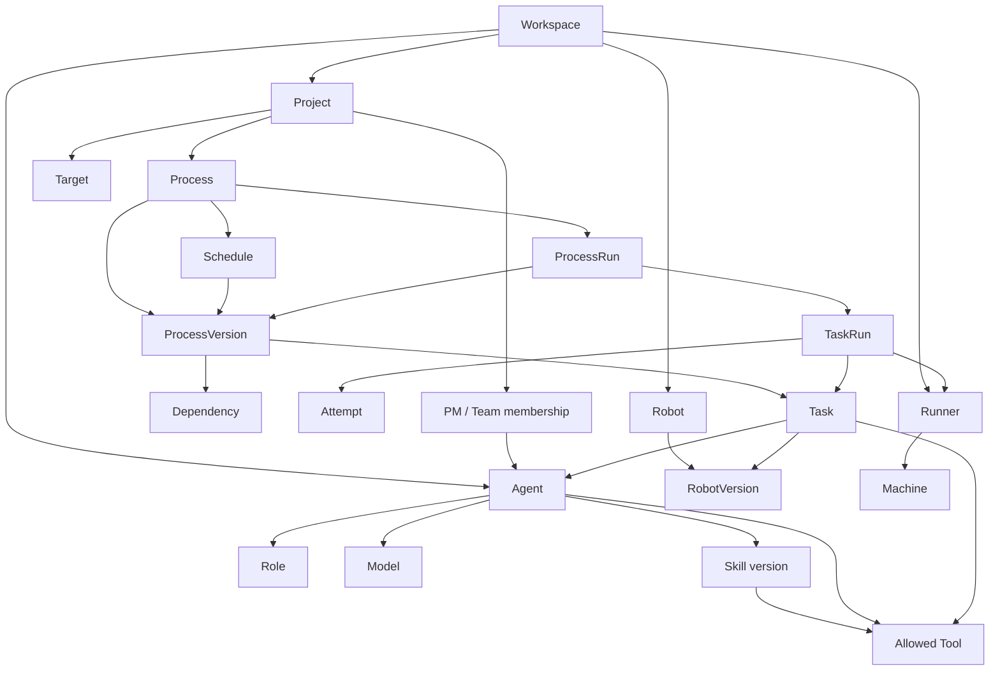

# Mô hình domain Agent CF

> Status: Design baseline  
> Last updated: 2026-11-17  
> Owner: Architecture

## Mục đích và phạm vi

Tài liệu này mô tả các khái niệm, quan hệ, vòng đời và bất biến nghiệp vụ của thiết kế nền MVP. Đây không phải database schema hoặc class diagram triển khai; ranh giới thành phần nằm ở overview và ADR.

Tên và nghĩa của thuật ngữ do [Glossary](../product/glossary.md) định nghĩa. Hành vi người dùng mong muốn do [Yêu cầu MVP](../product/requirements.md) định nghĩa.

Đã đối chiếu định hướng UI ngày 2026-11-13. Các quan hệ dưới đây phục vụ thiết kế backend sau này; prototype chỉ lưu bộ nhớ, chưa hiện thực aggregate hoặc lưu trữ bền vững. Workspace là ranh giới logic nội bộ, không phải mục trên menu.

## Bối cảnh domain



Mũi tên thể hiện quan hệ hoặc tham chiếu khái niệm, không quy định chiều foreign key hay cách lưu trữ.

## Cụm định nghĩa

### Workspace

Aggregate logic cao nhất cho dữ liệu cấu hình. MVP giả định một Workspace nên chưa xác định API quản lý vòng đời Workspace.

### Project

Project sở hữu Process về mặt tổ chức. Việc archive Project giữ ProcessVersion và lịch sử ProcessRun. Xóa có xác nhận là thao tác riêng, xóa vĩnh viễn aggregate cùng lịch sử đã kết thúc theo [ADR 0008](decisions/0008-explicit-aggregate-deletion.md); không xóa catalog dùng chung/file PC, chặn khi còn Run chưa kết thúc.

`working_directory` tùy chọn là root PC của Project (migration 019), bắt buộc khi dùng Skill local. Luồng cấu hình hiện tại lấy cwd từ Project cho mọi node Skill local; không có ô thư mục hoặc override cwd ở form node (PROC-006). Snapshot cũ/API lifecycle cũ giữ nguyên. PC mặc định theo nguồn Skill; snapshot lần chạy ghim root/PC. Ngữ cảnh chủ đề thuộc từng Run, không đổi cwd hoặc định nghĩa Process; xem [ADR 0009](decisions/0009-run-topic-context.md).

Project có PM; Team là view chỉ đọc của PM và Agent trong node ở phiên bản mới nhất đã lưu của mỗi Process thuộc Project, khử trùng theo Agent ID. Agent được chọn trực tiếp từ catalog active, không cần membership có sẵn. Bảng `project_team` cũ được giữ tương thích nhưng không dùng để hiển thị Team/kiểm publish; endpoint sửa Team cũ deprecated và trả 422, không thay dữ liệu. Target của Project có kỳ tuần/tháng, khoảng thời gian, tiêu chí nghiệm thu, mục tiêu và số kết quả được duyệt. Trạng thái thành công của ProcessRun không tự quyết định nghiệm thu Target; cách lưu bằng chứng và cơ chế duyệt thật cần thiết kế tiếp.

Nhân bản Project là sao chép cấu hình trong cùng Workspace, không phải tạo bản sao lần thực thi. Project/Process/ProcessVersion/Target/Schedule có identity mới; các tham chiếu nội bộ được ánh xạ lại, còn Agent/Skill/Robot/PC vẫn thuộc catalog dùng chung. Nội dung và trạng thái version được giữ, snapshot published của nguồn không bị sửa; Task ID/key và dependency nằm trong phạm vi version mới. Target giữ số liệu theo lựa chọn sản phẩm; số đó không tạo Run/Attempt giả. Schedule của bản sao luôn tắt và không mang con trỏ lần chạy hoặc tick của nguồn. Toàn bộ thao tác nguyên tử; audit ghi nguồn và bản sao. Chi tiết hành vi Web tại [requirements](../product/requirements.md#quản-lý-project-và-process-qua-giao-diện).

Thuộc tính khái niệm tối thiểu:

- identity;
- name và description;
- lifecycle status;
- created/updated timestamps.

### Process

Process thuộc một Project và lưu configuration_json hiện tại cùng configuration_revision. Lưu dùng token CAS; Team đọc cấu hình này, fallback bản lưu cũ. ProcessVersion giữ snapshot nội bộ bất biến cho từng Run; lifecycle draft cũ còn tương thích. Xem [ADR 0011](decisions/0011-save-and-run-current-configuration.md).

Process không chứa task thực thi trực tiếp; Task thuộc ProcessVersion.

### ProcessVersion

ProcessVersion là snapshot nội bộ của định nghĩa chạy; các trường lifecycle dưới đây được giữ tương thích API cũ, không là bước thao tác trên Web:

- số version tăng trong Process;
- trạng thái `draft` hoặc `published`;
- tập Task;
- tập Dependency;
- metadata tạo/publish.

Dòng draft nội bộ có thể thay đổi trước khi được dùng làm snapshot. Snapshot published là bất biến về mặt hành vi; metadata không ảnh hưởng thực thi có thể được bổ sung sau nhưng không được làm thay đổi nội dung đã chạy.

### Task và Dependency

Task có identity ổn định trong phạm vi một ProcessVersion, cấu hình thực thi, Agent được gán và tập Tool được phép dùng. Dependency nối Task nguồn với Task đích trong cùng version.

Task có thể là Agent task (dùng Skill/Tool) hoặc Robot task. Robot task tham chiếu RobotVersion bất biến, Agent chịu trách nhiệm output, Runner/PC và input riêng. Gán Agent/PC thuộc node trong ProcessVersion, không thuộc catalog Robot. Một Robot có nhiều version; thống kê chất lượng được tách theo RobotVersion. Thiết kế artifact/schema tại phần snapshot bên dưới; chưa có schema DB thực tế.

Đồ thị Task phải là đồ thị có hướng không chu trình. Task không có dependency đầu vào là task gốc; Task không có dependency đầu ra là task cuối.

### Schedule

Schedule thuộc một Process. Lịch trên Web theo cấu hình hiện tại khi đến hạn; process_version_id cũ giữ tương thích và snapshot kiểm tra ban đầu, không quyết định cấu hình Run mới khi follow_current_configuration bật. Schedule giữ quy tắc thời gian, thời điểm dự kiến kế tiếp, trạng thái bật/tắt và chiến lược chọn Runner. Chiến lược có thể chỉ định một Runner cụ thể hoặc yêu cầu hệ thống tự chọn Runner đủ năng lực.

## Cụm năng lực thực thi

### Agent

Agent thuộc Workspace và có identity độc lập với ProcessVersion. Agent cung cấp cấu hình năng lực và tập Tool tối đa được phép dùng.

Role là catalog có identity riêng, tên và mô tả nhiệm vụ: một Role được 0..n Agent tham chiếu, mỗi Agent chọn một Role. Tên Role thay đổi không đổi identity hoặc cấu hình riêng của Agent. Role được dùng thì Archive thay vì xóa mất tham chiếu. Permissions ở Role hiện là dữ liệu dự kiến, chưa có cơ chế thực thi; PM của Project là quan hệ được gán riêng, không suy ra từ tên hoặc quyền Role ở prototype.

Để bảo đảm run có thể tái hiện, ProcessVersion published phải giữ một execution snapshot hoặc tham chiếu version bất biến của cấu hình Agent cần thiết. Chọn execution snapshot tại publish theo ADR 0005; tham chiếu Agent mutable chỉ dùng liên kết catalog, không dùng tái dựng lịch sử.

### Skill và trách nhiệm Task

Skill mô tả cách làm và tiêu chuẩn output, có thể được nhiều Agent sử dụng. Task phải giữ Agent chịu trách nhiệm và tham chiếu Skill/version đã dùng. Skill bundle được ghim bằng digest và lưu bất biến tại publish theo phần snapshot bên dưới; prototype chưa phải triển khai.

Catalog Agent/Skill/Tool giữ identity ổn định khi đổi tên. Mục đã được tham chiếu không xóa cứng qua UI mà chuyển archived, chặn sử dụng cho run mới và giữ lịch sử. Archive không thay đổi snapshot của version đã publish; Restore không tự mở lại Schedule. Thiết kế snapshot bên dưới là cơ sở cho DATA-001; chưa có schema/migration triển khai.

### Tool và quyền hiệu lực

Tool là năng lực có identity và hợp đồng riêng. Quyền Tool hiệu lực của Task là giao giữa:

- Tool Agent được phép dùng;
- Tool Task yêu cầu hoặc được cấp trong ProcessVersion;
- chính sách bảo mật tại thời điểm thực thi.

Policy thời điểm thực thi có thể thu hẹp quyền nhưng không được âm thầm mở rộng quyền đã publish.

### Runner

Runner là danh tính thực thi thuộc Workspace, được hiện thực bởi Runner Client trên một Machine. Runner lưu trạng thái đăng ký, credential có thể thu hồi, phiên bản client, heartbeat gần nhất và năng lực đã được xác thực.

Client 0.3.0 có device identity ổn định và proof DPAPI, Server chỉ lưu proof hash; active device duy nhất theo Workspace. Reconnect bằng pairing target hoặc proof đúng giữ Runner ID, thay credential/session, không gộp theo tên. Hủy kết nối giữ identity/config; Xóa là vòng đời riêng. Telemetry CPU/RAM là sample OS qua heartbeat, không dùng làm chứng thực identity hoặc bằng chứng tool đã dừng. Xem [ADR 0010](decisions/0010-pc-device-identity.md).

Runner không phải aggregate sở hữu Process hoặc Task. Một TaskRun có thể được giao cho Runner phù hợp; lịch sử phải lưu đủ định danh Runner để chẩn đoán mà không gắn domain vào topology hạ tầng. Runner offline hoặc disabled không được nhận task mới.

### Cấu hình dùng chung

Provider và Model API là catalog cho **Agent điều phối**; `agent_snapshot.model_id` thuộc cấu hình API đó. **Công cụ AI thực thi** dùng catalog `ai_tool_models` riêng (migration 015), node giữ `runtime.tool_model_id`, exact `runtime.model_id` và `tool_model_snapshot`. Đổi Agent không đổi model CLI. Publish kiểm đúng công cụ, model đã bật và identifier; tắt model CLI chặn Run mới, không sửa version/lịch sử hoặc hủy run đang chạy. Trường runtime_adapter của model API từ migration 014 chỉ giữ tương thích, không dùng để phân loại model CLI. [ADR 0007](decisions/0007-orchestration-agents-and-ai-tools.md) chốt ranh giới. Role là catalog mô tả nhiệm vụ, không tự cấp quyền thực thi. General không viết lại ProcessVersion published. Vòng gọi API điều phối thật và secret provider cần triển khai/kiểm chứng riêng; catalog không chứng minh runtime điều phối đã chạy.

## Cụm lịch sử thực thi

### ProcessRun

ProcessRun là aggregate root của một lần chạy. Nó thuộc một Process và tham chiếu đúng một ProcessVersion published. Aggregate quản lý:

- input và output của run;
- trạng thái tổng thể;
- TaskRun thuộc lần chạy;
- thời điểm và lý do kết thúc;
- yêu cầu hủy.

ProcessRun không được chuyển sang version khác sau khi tạo.

Started/Ended là thời điểm thực thi, không suy ra từ log mẫu hoặc phần trăm tiến độ. Duration tính từ Started tới Ended, hoặc thời điểm hiện tại khi còn chạy; thiếu dữ liệu thì hiển thị `—`. Tiến độ UI là số TaskRun succeeded/tổng TaskRun của version, không phải phần trăm thời gian. Trạng thái xử lý cảnh báo lưu riêng khỏi trạng thái Run.

Token usage thuộc hoạt động Agent, không phải chi phí tiền. Prototype hiện có tổng tháng mẫu; mô hình ghi usage, phân bổ theo run/project và đối soát chưa được quyết định. Không phân bổ tổng Agent cho Project khi chưa có dữ liệu nguồn.

### TaskRun

MVP tạo đúng một TaskRun cho mỗi Task trong ProcessVersion. TaskRun thuộc đúng một ProcessRun và tham chiếu Task thuộc version của run đó.

TaskRun quản lý trạng thái lập lịch và kết quả logic. Lịch sử lần thực thi vật lý được mô hình hóa bằng Attempt để có thể mở rộng retry mà không ghi đè dữ liệu.

Use case thật cần Agent giám sát tool, xử lý lỗi có giới hạn, chờ người dùng và làm lại phần lỗi. Các khả năng đó chưa có trong graph/state machine prototype; cần thiết kế cách lưu yêu cầu can thiệp, quyết định người dùng, artifact được giữ lại và lịch sử lần thử trước khi triển khai. Không sửa output/status cũ để biểu diễn một lần làm lại.

Human/Continue phải giữ TaskRun succeeded và artifact đã đạt (ví dụ 3/5 node), tiếp tục đúng bước đang vướng sau can thiệp. Yêu cầu can thiệp và quyết định người dùng cần định danh để khử trùng; cách lưu chưa chốt. Tạm dừng chờ là trạng thái chưa kết thúc, không làm mất bất biến terminal state không chuyển ngược. Ánh xạ sang Temporal nằm tại [ADR 0003](decisions/0003-process-engine-temporal.md), không để domain phụ thuộc SDK.

### Attempt

Attempt lưu một lần giao và thực thi TaskRun, gồm Runner, thời điểm, kết quả hoặc lỗi kỹ thuật. Baseline chỉ cấp tối đa một Attempt trên mỗi TaskRun; quan hệ lưu trữ là 0..n để bổ sung retry có lịch sử. Attempt cùng quyền thực thi được tạo nguyên tử; trạng thái reconciling giữ trường hợp chưa rõ tiến trình/kết quả, không cấp lại chỉ vì lease hết hạn.

## Quan hệ và lực lượng số

| Nguồn | Quan hệ | Đích |
|---|---|---|
| Workspace | có 0..n | Project |
| Workspace | có 0..n | Agent |
| Workspace | có 0..n | Tool |
| Workspace | có 0..n | Runner |
| Project | có 0..n | Process |
| Project | chỉ định đúng 1 | Agent làm PM |
| Project | có 0..n | Agent thành viên (Team) |
| Project | có 0..n | Target |
| Agent | tham chiếu đúng 1 | Role |
| Role | được dùng bởi 0..n | Agent |
| Agent | tham chiếu 1 | Model |
| Model | thuộc 1 | Provider |
| Agent | dùng 0..n | Skill/version |
| Skill/version | yêu cầu 0..n | Tool |
| Robot | có 1..n | RobotVersion |
| Task loại Robot | tham chiếu đúng 1 | RobotVersion |
| Process | có 1..n | ProcessVersion |
| Process | có 0..n | Schedule |
| Schedule | tham chiếu đúng 1 | ProcessVersion published |
| ProcessVersion | có 1..n khi publish | Task |
| ProcessVersion | có 0..n | Dependency |
| Process | có 0..n | ProcessRun |
| ProcessRun | tham chiếu đúng 1 | ProcessVersion published |
| ProcessRun | có đúng 1 cho mỗi Task | TaskRun |
| TaskRun | tham chiếu đúng 1 | Task trong version của run |
| TaskRun | có 0..n; baseline cấp tối đa 1 | Attempt |

## Bất biến nghiệp vụ

1. Process và ProcessRun là hai thực thể khác nhau; Task và TaskRun cũng vậy.
2. Mọi ProcessRun tham chiếu đúng một ProcessVersion published và tham chiếu đó không đổi.
3. ProcessVersion published không được sửa nội dung ảnh hưởng hành vi.
4. Mỗi Dependency chỉ nối hai Task trong cùng ProcessVersion.
5. Đồ thị Task của version published có ít nhất một Task và không có chu trình.
6. Mỗi Task trong version phải tham chiếu cấu hình Agent có thể tái hiện khi chạy.
7. Tool Task yêu cầu không được vượt quyền Tool của Agent và policy thực thi.
8. Mỗi TaskRun thuộc đúng một ProcessRun và ánh xạ tới một Task trong version của run đó.
9. Trạng thái kết thúc không được chuyển ngược thành trạng thái hoạt động.
10. Lịch sử Attempt, output, error và AuditEvent không bị ghi đè để che giấu sự kiện đã xảy ra.
11. Runner phải thuộc Workspace của ProcessRun, còn hiệu lực và có năng lực phù hợp trước khi nhận TaskRun.
12. Schedule chỉ tạo run từ ProcessVersion đã publish và không tự đổi version khi Process có version mới.

## Vòng đời sơ bộ

Quyết định UI hiện hành: chỉ Project có Ngừng hoạt động/Kích hoạt lại. Các trạng thái archived/API lịch sử của Process, Agent và catalog bên dưới được giữ cho tương thích dữ liệu; Web không cung cấp thao tác hoặc bộ lọc Archive/Restore cho các mục này. Bỏ nút không tự khôi phục hay xóa dữ liệu đã archived.

### Project

```text
active -> archived
archived -> active  (Restore, không tự bật lại Schedule)
```

Project/Process chưa có ProcessRun được phép xóa sau xác nhận; xóa Project bao gồm các Process con. Nếu đã có lịch sử, chuyển sang archived và giữ nguyên dữ liệu tham chiếu; không cho archive khi còn bất kỳ run chưa terminal (queued/running/reconciling/cancelling). Archive tắt Schedule liên quan; Restore không tự bật lại lịch. Archived không nhận run mới.

### ProcessVersion

```text
draft -> published
```

Không có chuyển đổi ngược. Thay đổi version published tạo draft mới.

### Agent

```text
active <-> archived
```

Archived ngăn gán mới và run mới phụ thuộc Agent đó, tắt lịch liên quan nhưng giữ run đang chạy và lịch sử. Restore không bật lại lịch. Agent/Skill/Tool/Robot/Role chưa dùng có thể xóa sau xác nhận; mục đã dùng hoặc có tham chiếu được Archive. Đây là quy tắc vòng đời catalog, tách khỏi quyền runtime tương lai.

### Runner

```text
pending -> online <-> offline
online/offline -> disabled
```

`busy` là trạng thái khả dụng khi Runner online và đang thực thi; UI dùng nhãn Running và hỗ trợ xem node/Agent. Disabled ngăn nhận việc mới; Enable là thao tác chủ đích, không tự bật lại Schedule. Remove cần xác nhận, bị chặn khi còn bất kỳ run chưa terminal, giữ định danh trong lịch sử; ghép nối lại tạo danh tính mới. Web dùng Sửa tên/Xóa. Migration 013 đánh dấu `deleted_at` để ẩn PC đã gỡ và giữ quan hệ lịch sử. Xóa thu hồi credential/session, tắt lịch liên quan; không tác động file trên PC. API Enable không khôi phục PC đã xóa.

Vòng đời ProcessRun và TaskRun nằm tại [Mô hình thực thi](execution-model.md).

## Ranh giới nhất quán sơ bộ

- Publish ProcessVersion kiểm tra toàn bộ task graph như một đơn vị nhất quán.
- Tạo ProcessRun cố định version và tạo tập TaskRun tương ứng như một thao tác logic duy nhất.
- Chuyển trạng thái TaskRun phải bảo vệ khỏi hai Runner cùng nhận quyền thực thi đồng thời.
- Trạng thái ProcessRun được suy ra hoặc cập nhật nhất quán từ TaskRun và yêu cầu hủy; UI không tự ghi trạng thái tổng thể.

Database nghiệp vụ giai đoạn local đã chọn SQLite tại [ADR 0004](decisions/0004-sqlite-business-database.md). Schema/migration và locking sẽ triển khai ở DATA-001; transaction/inbox/outbox và giao việc đã thiết kế tại execution model, cần kiểm thử khi triển khai.

## Định nghĩa Process động và snapshot

Quyết định tại [ADR 0005](decisions/0005-versioned-process-execution.md); schema truyền dữ liệu tại [OpenAPI](../../openapi/openapi.yaml). Đây là thiết kế, không phải database đã triển khai. Process thuộc Project; hệ thống quản lý tổng giữ Project/Team/Targets, Agents, Skills/Tools, Robots, Runners và Settings theo module sở hữu. Engine chỉ đọc định nghĩa/version và quyền, không mã hóa riêng quy trình YouTube.

### Định danh và version

- ProcessVersion có ID riêng, số version tăng trong Process, revision dùng chống ghi đè draft và hai version kỹ thuật `definition_format_version`, `interpreter_version`.
- Task ID chỉ có nghĩa trong ProcessVersion. Clone draft giữ `task_key` để đối chiếu node giữa version nhưng tham chiếu thực thi luôn là `(process_version_id, task_id)`, không tìm Task của run qua bản draft mới nhất.
- Publish kiểm tra graph không rỗng/không cycle, khóa duy nhất task ID/key, cạnh không trùng, Agent tồn tại/active và catalog liên quan, snapshot và quyền/schema/mapping; không dùng membership Team làm điều kiện. Đóng băng toàn bộ hoặc không publish. Concurrent edit/publish cần expected revision. Published không chỉnh hành vi, clone tạo draft mới; tối đa một draft/Process.
- Một bộ thông dịch chạy graph dữ liệu, không tạo một Workflow type riêng cho Skill hoặc Process. Format/interpreter chưa hỗ trợ bị từ chối khi publish và start, không tự chuyển đổi.

### Nội dung bất biến

Skill có phạm vi catalog hiện tại: `is_global` hoặc tập `project_ids` qua quan hệ nhiều-nhiều; không trộn Global với Project cụ thể, khi tạo/sửa Skill riêng phải chọn ít nhất một Project. Publish và Run mới kiểm phạm vi hiện tại, không suy quyền từ việc Agent có Skill hoặc snapshot cũ. Thay scope không sửa nội dung/version/history; Project clone nhận thêm liên kết với Skill riêng của nguồn và không nhân đôi Skill. Xóa Project gỡ liên kết, không xóa Skill hoặc tự chuyển Global; Skill mất liên kết cuối cùng không khả dụng trong Project nào cho đến khi gán lại. Skill/Agent chỉ bị chặn xóa khi còn node Process tham chiếu, không chỉ vì version/snapshot/membership tồn tại.

Snapshot gồm instruction hiệu lực (Agent + Task), Agent ID/Role metadata tại publish, runtime adapter ID/version, model ID chính xác, Skill bundle ID/digest, Tool contract version/allowlist, RobotVersion khi có, input/output schema, mapping, Runner constraint và timeout policy. Chọn cấu hình runtime/model/Skill khác phải sửa draft rồi publish; request Run không override snapshot bằng chuỗi model/Skill mutable.

Skill/Robot bundle do Server quản lý theo ID và SHA-256, gồm nội dung hướng dẫn cùng tài sản được cấp phép; không chỉ lưu đường dẫn tới thư mục có thể sửa. Download chỉ phục vụ bundle đã được phép; Client kiểm digest trước staging. Adapter version là hợp đồng tương thích được xác nhận, không đoán từ tên chương trình. Credential binding chỉ là ID logic; secret không vào snapshot/history. Đổi secret không sửa nội dung ProcessVersion; policy hiện tại có thể thu hẹp quyền, không tự mở rộng.

Chế độ **Skill local** bổ sung tại [ADR 0006](decisions/0006-local-skill-paths-and-pc-outputs.md): snapshot giữ `source_path` tuyệt đối và `source_runner_id`; node ghim đúng PC cùng `working_directory`. Nội dung file gốc được đọc tại lần chạy, giữ tài nguyên tương đối và hash thực tế trong output Attempt; không dùng bundle inline thay file đó. Tham chiếu đã publish bất biến, file ngoài hệ thống có thể thay đổi giữa các lần chạy.

Snapshot digest dùng SHA-256 của JSON canonical UTF-8 (RFC 8785); digest bundle tính trên byte bundle gốc. Version/lịch sử còn tồn tại không được sửa; xóa aggregate có chủ đích là ngoại lệ DELETE theo ADR 0008. Catalog archive chặn run mới theo requirements, giữ snapshot/run cũ. Run ghi version ID/digest và input đã chuẩn hóa; không snapshot lại từ catalog khi dispatch.

### Schema và mapping

Input và output của Process/Task là JSON object có JSON Schema 2020-12. Không resolve `$ref` qua mạng hoặc file; chỉ `$ref` nội bộ tài liệu schema. Giới hạn kích thước/độ sâu/schema được cấu hình ở Server, không thực thi script hay custom validator do Web gửi.

Mapping là danh sách các binding tới trường cấp đầu `target`, duy nhất trong một mapping. Nguồn là literal JSON, run_input + JSON Pointer RFC6901 hoặc task_output + task_id + pointer. Pointer không tồn tại là lỗi (giá trị null tồn tại vẫn là dữ liệu); nguồn task_output phải thuộc tổ tiên của Task đích. Kiểm tra cấu trúc mapping ở publish, giải quyết giá trị và validate input ở runtime; không giả định mọi kiểu schema có thể được chứng minh tĩnh. Input không khai báo trong mapping không được tự lấy từ log hoặc nối chuỗi prompt. Mỗi trường bắt buộc phải được mapping hoặc có schema default được Server áp dụng rõ ràng trước validation.

Output run là JSON object với key là Task ID của mọi Task cuối và value là toàn bộ output tương ứng; output_schema do Server suy ra tại publish, không nhận mapping output tùy chỉnh trong baseline (REQ-RUN-05). Với output trên PC, JSON chứa metadata `runner_id`, `working_directory`, `skill_source_path`, hash Skill thực tế và `local_files` gồm đường dẫn tuyệt đối/kích thước/hash; không nhúng video/audio hoặc tự upload mọi loại file. Client kiểm file thật trước báo kết quả; đường dẫn không phải quyền đọc file qua Server. Bản sao được upload biểu diễn riêng bằng ArtifactRef (ID, Attempt, logical name, media type, size, SHA-256 và availability), chỉ sẵn sàng khi upload đã finalize. Thành công của chế độ local không cần có ArtifactRef; không dùng metadata PC như bằng chứng file tồn tại trên PC khác.

### Event, quyền và artifact

ProcessRun có revision tăng đơn điệu, TaskRun giữ input/output/error và Attempt history. Attempt sở hữu execution grant (Runner/session/generation/expiry/token hash), launch evidence và stop_reason. Event/audit/inbox/outbox bất biến hoặc có tiến độ chuyển phát riêng, không phải menu hoặc Process mới. Transaction của use case runs phối hợp repository qua interface công khai; không cho module ghi trực tiếp bảng của nhau.

Artifact byte và bundle lưu trong vùng dữ liệu Server ngoài Git, theo ID/digest, không overwrite. Upload theo Artifact ID được giới hạn size/checksum; không tin filename hoặc đường dẫn Client cung cấp. Web tải bằng endpoint có kiểm quyền; artifact không tự trở thành file công khai. Chưa có retention tự động hoặc triển khai kho artifact; DATA-001/RUN-002 phải hiện thực và kiểm thử.

## Các quyết định còn mở

- Mô hình Tool, credential và policy chi tiết.
- Thời hạn lưu giữ, quyền truy cập và xử lý dữ liệu nhạy cảm sau archive; hành vi Delete/Archive/Restore trên UI đã xác định trong requirements.
- Retention/partition của AuditEvent; execution grant thuộc Attempt, không tạo aggregate sở hữu nghiệp vụ riêng.

Các lựa chọn ảnh hưởng rộng phải được ghi bằng ADR trước hoặc trong thay đổi triển khai.
