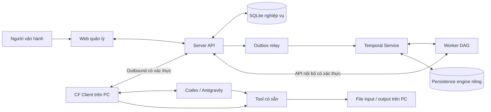

# Kiến trúc Agent CF — arc42

> Status: Draft  
> Last updated: 2026-11-16  
> Owner: Engineering

Đây là **tài liệu kiến trúc chính**, tổ chức theo 12 mục của [arc42](https://arc42.org/overview/), trình bày ngắn theo phạm vi hiện tại. Domain model, execution model và ADR được liên kết làm phần chi tiết; không sao chép toàn bộ vào đây. Áp dụng arc42 không tự chấp thuận các đề xuất công nghệ hoặc chứng minh ứng dụng đã chạy.

**Trạng thái triển khai:** chưa có ứng dụng Web → Server → Client hoặc schema DB chạy thật. Các phép thử CLI/Skill độc lập được ghi trong [báo cáo runtime](../reports/local-runtime-check.md) và [báo cáo Skill 0](../reports/local-skill0-check.md). Tiến độ tổng theo dõi tại [plan](../development/implementation-plan.md); task chi tiết và bằng chứng hoàn thành nằm trong [thư mục task theo module](../development/tasks/README.md).

## 1. Giới thiệu và mục tiêu

Agent CF giúp người vận hành giao việc, theo dõi và can thiệp từ Web. Agent chịu trách nhiệm điều phối/đánh giá; Codex hoặc Antigravity là runtime thực thi Skill và gọi tool có sẵn trên PC. Nhu cầu đại diện là sản xuất video YouTube; tích hợp các tool người dùng đang có, không mặc định xây lại chúng.

Web thay người điều khiển PC, giữ nguyên quy trình Skill; output gốc ở PC, upload/preview trên Web là tùy chọn. Skill local tham chiếu file `.md` chính bằng đường dẫn tuyệt đối trên PC đã chọn và thực thi tại thư mục làm việc của node; [ADR 0006](decisions/0006-local-skill-paths-and-pc-outputs.md) bổ sung chế độ này, [requirements](../product/requirements.md#giữ-quy-trình-và-output-trên-pc) giữ yêu cầu chuẩn.

[ADR 0007](decisions/0007-orchestration-agents-and-ai-tools.md) phân biệt **Agent điều phối** dùng Model API để giao việc/kiểm tra và **Công cụ AI thực thi** Codex/Antigravity dùng model CLI riêng trên PC. SET-005 đã tách catalog/UI/validation; chưa triển khai vòng LLM API điều phối tổng quát, không dùng review tiêu chí xác định hoặc fixture để tuyên bố đã có vòng đó.

Mục tiêu kiến trúc: công việc tiếp tục khi đóng Web; kết quả và lịch sử truy vết được; sửa một module hạn chế ảnh hưởng sang module khác. Phạm vi sản phẩm lấy từ [vision](../product/vision.md), hành vi lấy từ [requirements](../product/requirements.md), quy trình thật lấy từ [use case YouTube](../product/use-cases/youtube-video.md).

## 2. Ràng buộc

- Runtime và tool phải chạy trên PC có môi trường, quyền và phiên đăng nhập phù hợp. Đổi máy không tự chuyển tài khoản, quota hoặc Skill cài ngoài repo.
- DB nghiệp vụ local đã chốt SQLite tại ADR 0004. Stack, Client và Temporal local đã Accepted về thiết kế; xem mục 9. Chưa kiểm chứng tích hợp.
- Prototype HTML chỉ phục vụ review giao diện. Không dùng dữ liệu mẫu hoặc khả năng chat của CLI để khẳng định ứng dụng đã tích hợp.
- Cấu hình runtime, đường dẫn và secret thuộc từng máy; không hard-code hoặc đưa credential vào source/log.

## 3. Bối cảnh và phạm vi hệ thống

Sơ đồ là **thiết kế đích**. Bên ngoài Agent CF là runtime, tool, dịch vụ được gọi và môi trường Windows của người dùng. Agent CF chịu trách nhiệm cấu hình, giao việc, theo dõi, quyết định và tham chiếu kết quả; không tự có quyền điều khiển toàn bộ PC. Hợp đồng HTTP và giao thức Client chưa triển khai.

## 4. Chiến lược giải pháp

- Monorepo gồm Web, Server và CF Client; nghiệp vụ tách khỏi giao diện, HTTP và adapter runtime.
- Server sở hữu dữ liệu nghiệp vụ. Web và Client dùng hợp đồng API, không mở file SQLite trực tiếp.
- Process lưu cấu hình hiện tại; mỗi Run tự chụp snapshot bất biến khi khởi chạy, theo ADR 0011. Giao việc và chờ kết quả độc lập vòng đời request HTTP.
- Tích hợp CLI/App Server qua adapter được kiểm chứng. Danh mục model tách nhãn hiển thị, runtime ID và khả dụng theo tài khoản; không âm thầm thay model.
- Temporal đã chọn cho thiết kế local; chưa kiểm chứng tích hợp. Lưu trữ Temporal là vấn đề riêng với SQLite nghiệp vụ.

BASE-001 đã hoàn thiện thiết kế nền cho hệ thống quản lý tổng và Process động; [ADR 0005](decisions/0005-versioned-process-execution.md) chốt snapshot, interpreter có version và inbox/outbox. Skill 0–1–2 chỉ là dữ liệu test. ADR phân biệt việc chấp thuận thiết kế với bằng chứng kiểm chứng từng khả năng; không cần đợi Human/Continue hoàn tất để chốt phương án xây dựng. Các tiêu chí triển khai nằm tại [ADR engine](decisions/0003-process-engine-temporal.md#điều-kiện-kiểm-chứng-khi-triển-khai), thứ tự task nằm trong plan.

Lý do lựa chọn và phương án thay thế nằm trong ADR ở mục 9; công việc triển khai nằm trong [file đầu việc theo module](../development/tasks/README.md), thứ tự liên module nằm trong plan.

## 5. Cấu trúc thành phần

| Thành phần | Trách nhiệm và ranh giới |
|---|---|
| Web | Project/Process, cấu hình node, Runs/Logs, kết quả và thao tác can thiệp; không tự định nghĩa lại vòng đời Run |
| Server API | Xác thực, validation, nhận lệnh/sự kiện, cung cấp dữ liệu; không gom nghiệp vụ vào handler |
| Điều phối | Dependency/version, lịch chạy, giao việc, timeout, hủy và chờ quyết định; worker Temporal riêng, Activity qua API nội bộ Server; xem ADR engine |
| Persistence | Định nghĩa/version, lịch sử, quyết định và tham chiếu artifact; không chỉ giữ trạng thái trong RAM |
| CF Client | Kết nối, kiểm tra khả dụng, quản lý tiến trình runtime/tool, log/output, heartbeat và yêu cầu hủy |
| Adapter runtime/tool | Chuyển cấu hình/input/lệnh và sự kiện/output/error; không phụ thuộc UI |

Vị trí module theo menu và lớp được quản lý tại [project structure](../development/project-structure.md). Quan hệ Project, ProcessVersion, Task, Agent, Runner và các aggregate nằm tại [domain model](domain-model.md).

## 6. Luồng thực thi

### 6.1. Luồng đầu tiên: tạo cốt truyện

Người dùng chọn Process và thư mục chủ đề/input trên Web → Server kiểm tra cấu hình hiện tại, tự chụp snapshot và lưu Run gắn ProcessVersion nội bộ → Client nhận việc → adapter gọi runtime → kết quả/log được báo về và lưu → Web đọc lại trạng thái cùng artifact.

Luồng này chưa được tích hợp. Phép thử đã thành công là Codex sinh dàn ý và CLI xuất phản hồi cuối ra file; không coi đó là bằng chứng model tự gọi tool ghi file. Xem [báo cáo Skill 0](../reports/local-skill0-check.md).

Đây là mốc tích hợp [RUN-006](../development/tasks/runs/003-skill0-web.md#run-006): chạy riêng Skill 0 bằng Codex, chưa có Agent duyệt hoặc Skill 1/2; chưa phải nghiệm thu MVP tổng thể. Phạm vi chuẩn của mốc và luồng ba Skill nằm tại [requirements](../product/requirements.md#cấu-hình-node-dùng-runtime-local).

### 6.2. Luồng nội dung có Agent duyệt

Theo yêu cầu hiện tại, Agent trên hệ thống thay người giao việc, đọc kết quả, duyệt hoặc yêu cầu sửa; runtime local thực thi Skill 0 → 1 → 2. Skill 1 giữ checkpoint từng Part để Agent đánh giá. Vượt giới hạn xử lý thì yêu cầu người dùng can thiệp. Nhánh tự tìm chủ đề để sau và người dùng duyệt chủ đề trước khi chạy.

Cách thực thi đánh giá, tiêu chí duyệt và giới hạn sửa cần thiết kế trước khi code. Nguồn hành vi tại [cấu hình node runtime](../product/requirements.md#cấu-hình-node-dùng-runtime-local); trạng thái, retry/timeout/hủy và Human/Continue chi tiết tại [execution model](execution-model.md).

### 6.3. Lỗi và gián đoạn

Runtime lỗi hoặc thiếu output phải thành lỗi có ngữ cảnh. Client mất kết nối không tự chứng minh tiến trình đã dừng; phải đối soát trước khi chạy lại. Hủy/timeout không đồng nghĩa hoàn tác side effect. Kết quả đến muộn hoặc yêu cầu Continue trùng không được ghi đè trạng thái hoặc tạo thêm việc ngoài chính sách. Lease/reconciling đã thiết kế tại execution model; recovery đầy đủ cần REL-001.

## 7. Triển khai

Topology local tại ADR 0003: Web, API Server (chứa outbox relay), Temporal Service, worker và CF Client có vòng đời process riêng cùng PC. SQLite nghiệp vụ thuộc Server; Temporal development server lưu file riêng, bind loopback. Chưa có bộ cài/lệnh chạy ứng dụng được nghiệm thu.

Khi tách máy, Server/DB có thể ở máy riêng, Client chủ động kết nối outbound có xác thực. HTTPS là kênh lệnh/kết quả theo [OpenAPI](../../openapi/openapi.yaml) và [contract Client](client-protocol.md); WebSocket chỉ thông báo. Xác thực chưa triển khai. Không chia sẻ file SQLite qua mạng để nhiều PC mở trực tiếp. Thiết kế nhiều PC dùng artifact qua Server và Runner constraint theo execution model, chưa kiểm chứng.

Client trong phiên Windows đã chốt tại ADR Client; tray triển khai sau entrypoint console. Tool thao tác desktop có thể cần phiên đăng nhập hoạt động; khả năng chạy khi khóa màn hình/đăng xuất phải thử theo từng tool. Cài môi trường hiện có theo [setup](../development/setup.md); chưa có Temporal Service/worker thật.

Trách nhiệm triển khai trong plan: [BASE-001](../development/tasks/base/001-foundation-design.md#base-001) chốt topology/persistence và ranh giới API/worker/Client; [BASE-002](../development/tasks/base/002-application-bootstrap.md#base-002) dựng khung ba ứng dụng; [BASE-003](../development/tasks/base/002-application-bootstrap.md#base-003) dựng Temporal Service và worker riêng, kiểm tra lưu lịch sử điều phối. [RUN-002](../development/tasks/runs/002-run-execution-history.md#run-002) tích hợp giao việc thật qua Client. [REL-004](../development/tasks/execution/001-execution-permissions.md#rel-004) thiết kế quyền nhận việc/chống trùng trước hợp đồng API và giao việc; [REL-001](../development/tasks/execution/002-recovery.md#rel-001) bổ sung đối soát sau gián đoạn. Chọn Temporal không thay thế các cơ chế này của ứng dụng.

## 8. Các quy tắc chung

- **Version và lịch sử:** tách định nghĩa với lần chạy; cố định cấu hình Agent/Skill cần thiết để truy vết. Thiết kế snapshot chi tiết xem domain model.
- **Quyền:** kiểm tra ở Server/Client đáng tin cậy, không chỉ ẩn nút. Role/Permissions trong prototype chưa phải cơ chế thực thi.
- **Artifact:** DB giữ metadata/tham chiếu; nội dung lớn lưu thành file. Giữ phiên bản và output đã đạt khi xử lý lại; đường dẫn local không tự truy cập được từ máy khác.
- **Quan sát:** log, output và audit là thông tin khác nhau; gắn Run/TaskRun/Attempt xuyên luồng, không log secret hoặc toàn bộ payload nhạy cảm.
- **Thay đổi code:** module sở hữu nghiệp vụ công bố điểm truy cập rõ; không import nội bộ hoặc tạo phụ thuộc vòng. Contract/schema/config là nguồn thực thi khi được tạo.

Quy tắc bắt buộc và ma trận cập nhật nằm tại [AGENTS.md](../../AGENTS.md). Các điểm trên là tóm tắt kiến trúc, không thay thế nguồn chi tiết.

## 9. Quyết định kiến trúc

| ADR | Nội dung | Trạng thái quyết định |
|---|---|---|
| [0001](decisions/0001-application-stack.md) | Stack ứng dụng và ranh giới thực thi | Accepted về thiết kế stack; DB tại 0004 |
| [0002](decisions/0002-cf-client-windows.md) | CF Client trong phiên người dùng Windows | Accepted về thiết kế, chưa tích hợp |
| [0003](decisions/0003-process-engine-temporal.md) | Temporal và Human/Continue | Accepted về thiết kế, chưa tích hợp |
| [0004](decisions/0004-sqlite-business-database.md) | SQLite cho DB nghiệp vụ local; hướng chuyển PostgreSQL | Accepted; chưa có schema/migration |
| [0005](decisions/0005-versioned-process-execution.md) | Process động, snapshot, mapping, inbox/outbox và quyền thực thi | Accepted về thiết kế; chưa triển khai |
| [0006](decisions/0006-local-skill-paths-and-pc-outputs.md) | Skill gốc bằng đường dẫn tuyệt đối, giữ quy trình và output trên PC | Accepted; phạm vi triển khai/kiểm chứng tại RTM-009 |
| [0008](decisions/0008-explicit-aggregate-deletion.md) | Xóa chủ đích aggregate và danh mục không còn dùng | Accepted; ngoại lệ DELETE có phạm vi, giữ bất biến khi cập nhật |
| [0009](decisions/0009-run-topic-context.md) | Chủ đề chung của lần chạy Skill local, giữ cwd Project | Accepted; metadata path qua Client, snapshot ghim root |
| [0011](decisions/0011-save-and-run-current-configuration.md) | Lưu và dùng ngay; Robot giữ version, Run tự chụp cấu hình | Accepted; migration 022, API lifecycle cũ tương thích |
| [0010](decisions/0010-pc-device-identity.md) | Identity PC ổn định, reconnect/disconnect và telemetry | Accepted; credential tách device, proof không lộ trên API |

Giữ nguyên lịch sử quyết định. Accepted ghi nhận sự chấp thuận trong phạm vi ADR, không phải trạng thái đã triển khai. Chi tiết và lý do chỉ duy trì ở từng ADR.

## 10. Yêu cầu chất lượng

| Tình huống cần kiểm tra khi triển khai | Kết quả mong muốn |
|---|---|
| Đóng/mở lại Web trong lúc chạy | Công việc tiếp tục; đọc lại lịch sử/kết quả đã lưu |
| Runtime exit 0 nhưng output rỗng hoặc hỏng | Báo lỗi, không ghi thành công giả |
| Giao việc/Continue trùng hoặc kết quả đến muộn | Không chạy trùng, không ghi đè trạng thái kết thúc |
| Hủy, timeout hoặc gián đoạn | Trạng thái và tiến trình thực tế được đối soát, giữ phần đạt và lịch sử |
| Đổi Process sau khi đã chạy | Run cũ giữ đúng version/cấu hình đã khởi chạy |

Đây là tiêu chí thiết kế, chưa phải test tích hợp đã đạt. Yêu cầu chuẩn tại [requirements](../product/requirements.md#yêu-cầu-chất-lượng), các kịch bản execution tại [execution model](execution-model.md#kịch-bản-cần-kiểm-thử-khi-triển-khai).

## 11. Rủi ro và vấn đề còn mở

| Vấn đề | Cần giải quyết trước phần triển khai liên quan |
|---|---|
| Temporal local chưa dựng/kiểm chứng | BASE-003 kiểm chứng persistence riêng, Python 3.14/SDK, restart và replay theo ADR 0003 |
| Antigravity print/pipe, ID model và khác biệt IDE/CLI | Kiểm chứng đường gọi ứng dụng, giữ đủ nhãn nhưng không đoán ID/quyền; xem [báo cáo](../reports/local-runtime-check.md) |
| Timeout wrapper Windows còn để lại chương trình con | Quản lý đúng cây tiến trình và quyền chạy, không chỉ dựa exit code của wrapper |
| Snapshot/lease/outbox chưa triển khai; Human chưa thiết kế chi tiết | DATA-001/RUN-002/CLI-001 theo baseline; REL-001 recovery, REL-003 trạng thái chờ duyệt |
| Dispatch/upload nhiều máy chưa kiểm chứng | PC node ràng buộc, Manual/Schedule là mặc định; artifact qua Server bằng ID |
| Usage, secret store, ghép nối và cập nhật Client chưa tích hợp | Có nguồn số liệu và kiểm soát quyền thật; thiếu usage thì thể hiện chưa có dữ liệu |

Thứ tự xử lý và bản đồ module nằm tại [implementation plan](../development/implementation-plan.md); task chi tiết nằm tại [file đầu việc của từng module](../development/tasks/README.md). Báo cáo thử nghiệm là bằng chứng theo thời điểm, không phải danh mục khả dụng vĩnh viễn.

## 12. Thuật ngữ

Nguồn chuẩn duy nhất là [glossary](../product/glossary.md). Cần phân biệt Agent nghiệp vụ với runtime Codex/Antigravity; Process/Task với ProcessRun/TaskRun; menu PC với Runner/Runner Client/Machine. Domain model dùng các thuật ngữ này để mô tả quan hệ, không định nghĩa lại tên.

---

Khung tham chiếu: [arc42 — tổng quan 12 mục](https://arc42.org/overview/) của Gernot Starke và Peter Hruschka; [mục 9 và cách dùng ADR](https://docs.arc42.org/section-9/). Nội dung trong tài liệu là mô tả của Agent CF; việc áp dụng khung không phải chứng nhận ISO hoặc nghiệm thu toàn bộ kiến trúc.
